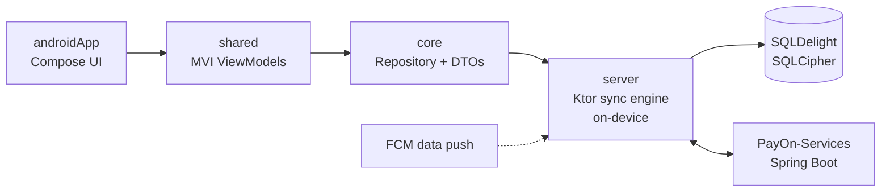

# PayOn

> Offline-first mobile payment app built with **Kotlin Multiplatform** and **Jetpack Compose**, powered by an on-device sync engine.


PayOn is the client side of a digital payment system: wallet balance, transfers, merchant payments, and notifications. It is designed **architecture-first** and **offline-first**: the app never talks to the backend directly. Every request goes through a Ktor server that runs *on the phone itself*, which syncs and stores data locally so the app is always up to date, even when it was closed.

The backend lives in a separate repository: **[PayOn-Services](https://github.com/YousefMoPrince/PayOn-Services)** (Spring Boot).

---

## Why this architecture?

The first version was a single Android module. Its WebSocket notifications died whenever the app was closed, so the app was rebuilt around a sync engine:

1. When the app closes, it reports its status as **offline**.
2. The Core Server sends a **data-only FCM push** containing only a `notificationId` and a `transactionId`. Fintech notification content never passes through FCM.
3. The push wakes the on-device sync engine, which makes three requests:
   - fetch the notification to display,
   - fetch the transaction and store it in the local database,
   - query the wallet balance (JWT) and update it locally.
4. When the user opens the app, everything is already there.

The platform-independent design also keeps a future iOS target cheap.



## Modules

| Module | Type | Responsibility |
|---|---|---|
| `app/androidApp` | Android | Activities and all Android-specific dependencies |
| `app/shared` | Compose Multiplatform | MVI building blocks: Intent, State, SideEffect, ViewModel, and screens |
| `core` | Kotlin Multiplatform | DTOs, Repository, Network, SQLDelight |
| `server` | Kotlin/JVM (Ktor) | On-device ClientSide-Server / sync engine that routes every API call and handles FCM-triggered background sync |

Only `androidApp` depends on Android APIs. `core`, `shared` and `server` stay native Kotlin / KMP so other platforms can reuse them.

## Tech Stack

- **Kotlin Multiplatform**, **Jetpack / Compose Multiplatform**
- **MVI** with `StateFlow` and `Channel`
- **Ktor** (embedded sync engine), **Koin** (dependency injection)
- **SQLDelight** over **SQLCipher**-encrypted SQLite
- **Firebase Cloud Messaging** (data-only push)
- **Gradle** (Kotlin DSL)

## Getting Started

### Prerequisites

- Android Studio (latest stable) and JDK 17+
- A running instance of [PayOn-Services](https://github.com/YousefMoPrince/PayOn-Services), or access to a deployed one
- A Firebase project for FCM

### Firebase setup

`google-services.json` is intentionally **not** committed. Create your own Android app in the Firebase console, download its `google-services.json`, and place it at:

```
app/androidApp/google-services.json
```

### Build and run

```bash
git clone https://github.com/YousefMoPrince/PayOnApp.git
cd PayOnApp

# Android debug build
./gradlew :app:androidApp:assembleDebug
```

On Windows use `gradlew.bat`. You can also run the `androidApp` configuration directly from Android Studio.

### Run tests

```bash
./gradlew :app:shared:testAndroidHostTest   # Android host tests
./gradlew :server:test                      # Sync engine tests
```

## Project Structure

```
PayOnApp
├── app
│   ├── androidApp   # Android entry point
│   └── shared       # MVI + Compose UI
├── core             # DTOs, repositories, networking, database
├── server           # Ktor on-device sync engine
├── gradle           # Version catalog and wrapper
└── build.gradle.kts
```

## Related

- **[PayOn-Services](https://github.com/YousefMoPrince/PayOn-Services)**: Spring Boot Core Server (PostgreSQL, MongoDB, Redis)

## License

Distributed under the Apache License 2.0. See [`LICENSE`](LICENSE) for details.

## Author

**Yousef Mohamed** - Software Architect & Engineer
[GitHub](https://github.com/YousefMoPrince) · [LinkedIn](https://linkedin.com/in/yousef-elprince)
